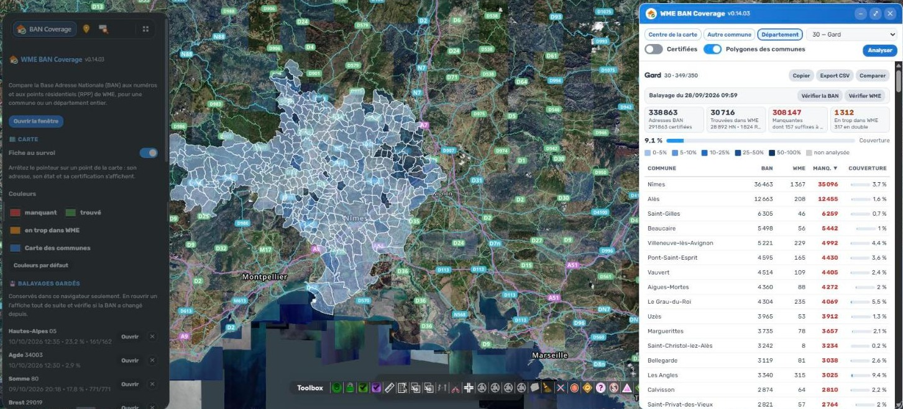
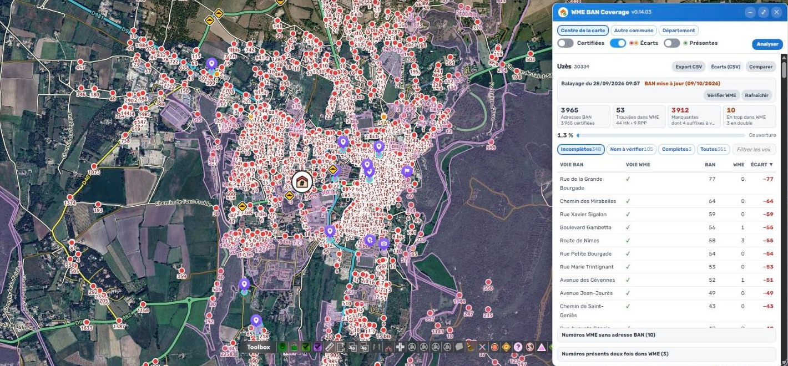
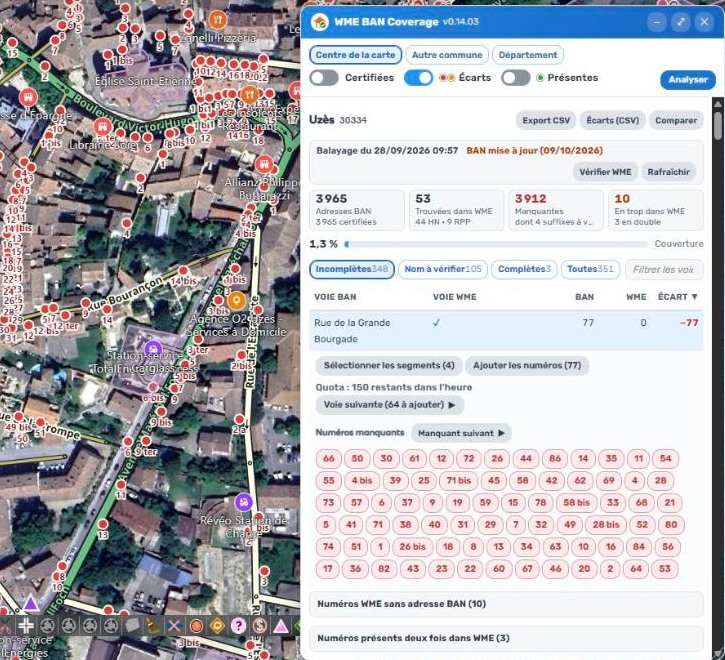

# WME BAN Coverage (WBC)

Pour une **commune** ou un **département entier**, WBC compare la Base Adresse Nationale (BAN) aux
numéros de WME, qu'ils soient posés sur les segments (HN) ou en points résidentiels (RPP). Il rend
les chiffres, les statistiques et un **état des lieux voie par voie** : ce qui manque, ce qui est en
trop, et les voies dont le nom ne correspond pas.

**Tout est calculé en direct, et rien ne quitte le navigateur.** La BAN est lue sur sa plateforme
nationale (adresse.data.gouv.fr), les contours et listes de communes sur geo.api.gouv.fr (qui reçoit
le centre de la carte et les recherches de commune), et WME sur les serveurs de l'éditeur, sans avoir
à parcourir la carte. Les balayages et les préférences (périmètre, interrupteurs, place de la fenêtre,
couleurs des points) restent dans le navigateur. Seuls GreasyFork et GitHub sont lus en plus, sans
rien recevoir : la version publiée et la version minimale (voir ci-dessous).

## Captures (0.14.03)

Un département entier — ici le Gard, 349 communes balayées : chaque commune colorée selon sa
couverture, le tableau des communes, et le panneau de l'onglet Scripts.



Une commune — Uzès : les adresses BAN manquantes en rouge sur la carte, les chiffres et l'état des
lieux voie par voie.



Une voie dépliée : ses numéros manquants, « Sélectionner les segments », « Ajouter les numéros »
(L6) avec le quota restant, et « Voie suivante ».



## Installation et mises à jour

- **Installation** : depuis GreasyFork, [script 600088](https://greasyfork.org/scripts/600088-wme-ban-coverage),
  avec Tampermonkey. Le code source est sur [GitHub](https://github.com/DrSlump34/WME-BAN-Coverage).
- **Mises à jour automatiques** : le gestionnaire de scripts suit GreasyFork. Une nouvelle version publiée
  s'annonce aussi par une pastille rouge en tête de l'onglet Scripts (vérification au plus une fois par
  24 h), avec un lien « Installer ».
- **Version retirée = bloquée** : au démarrage, le script lit `version-min.json` à la racine du dépôt. Une
  version plus ancienne que `min`, ou dont le code ne correspond pas à l'empreinte publiée pour elle (copie
  modifiée), ne démarre pas : un bandeau invite à la mettre à jour ou à la réinstaller. Si le fichier est
  injoignable, le script démarre normalement.

## Balayages gardés et mises à jour (0.06)

- Chaque balayage (commune ou département) est gardé dans le navigateur (IndexedDB). Choisir de
  nouveau le même périmètre, ou « Ouvrir » dans l'onglet Scripts, l'affiche aussitôt avec sa date.
- **BAN** : vérifiée d'office à l'ouverture d'une commune (une requête) ; pour un département, sur
  demande par « Vérifier la BAN » (0.09 : 349 requêtes d'office donnaient l'impression d'un nouveau balayage). Le fichier d'adresses de chaque commune est comparé à
  celui du balayage par son ETag (une requête HEAD, quelques centaines d'octets) ; la date de
  révision (`api/district/cog/<code>`) n'est lue que pour les communes signalées, pour l'afficher.
  La date seule ne suffirait pas : la révision précède de quelques heures la publication du fichier.
- **WME** : « Vérifier WME » relit la zone, numéros compris, et compare le nombre et la date des
  segments, les points résidentiels, et **chaque numéro** (identifiant, valeur, segment, position,
  résumés en une empreinte). Les numéros (HN) n'ont aucune date dans WME, et **en ajouter un ne
  change pas la date de son segment** (mesuré le 27/09/2026 sur un vrai ajout : 15 Chemin des Dames,
  Bagnols-sur-Cèze, segment resté daté de 2019) : seule la comparaison un par un les voit.
- Les communes signalées portent une étiquette BAN ou WME et un contour orange sur la carte ;
  « Rafraîchir » ne rebalaie qu'elles, et le nouveau balayage est comparé d'office au précédent.
- **Avant d'analyser (0.08)** : si le même périmètre (même filtre des certifiées) a déjà été balayé,
  « Analyser » affiche d'abord sa date, sa couverture et, pour une commune, l'état de la BAN (ETag),
  avec **Ouvrir** et **Relancer** — un département ne se relance plus en plusieurs minutes pour rien.
  Un avertissement, pas un verrou. En « Centre de la carte », la commune localisée est celle relancée.

## Fenêtre

- **Réduire** (0.08) : le bouton « − » de l'en-tête replie la fenêtre ;
  il reste l'en-tête et, pendant un passage, la ligne d'avancement et sa barre (mesuré : 42 px,
  88 px en cours d'analyse). La hauteur dépliée est gardée, même si on la déplace repliée ; l'état
  est retenu d'un chargement à l'autre.
- **Chaque attente se voit (0.09)** : durée connue ⇒ barre qui avance (analyse ; « Vérifier la BAN » d'un
  département : « Mises à jour BAN 61/349 » sur la barre principale, jamais sous un nom de commune) ; durée inconnue ⇒ barre animée
  (localisation, relecture d'un balayage, liste des départements, export relu) ou roue dans la ligne
  (vérification BAN d'une commune, recherche de commune, suppression d'un balayage). Jamais un texte
  seul. La barre animée bouge par `transform`, elle continue quand la page calcule.
- **Chaque bouton a son infobulle (0.09)**, et les lignes cliquables des tableaux aussi, dans les 8 langues.
- **Vue d'ensemble (0.09)** : choisir une commune ou un département (recherche, liste, onglet Scripts,
  ligne du tableau) cadre la carte sur son emprise entière. Seule l'emprise est demandée à
  geo.api.gouv.fr ; celle d'un département est l'union de ses communes, gardée le temps de la session.

- **Cadrage dans la zone visible (0.10)** : une commune, un département, une voie ou une adresse se
  cadrent au milieu de la partie de carte que la fenêtre ne couvre pas (4 découpes autour d'elle,
  la plus grande gagne — repliée, elle n'ôte qu'une bande), zoom calculé en Mercator sur cette zone.
- **Carte du département (0.11)** : classes FIXES resserrées 0-5 / 5-10 / 10-25 / 25-50 / 50-100 %
  (en tranches de 20 points, 316 communes du Gard sur 350 tombaient dans la première). La couleur se
  règle dans l'onglet Scripts (« Carte des communes ») : la rampe garde sa teinte et vise cinq
  luminances fixes, d'où un contraste régulier entre classes (1,47 à 1,69) quelle que soit la couleur,
  jaune compris.
- **Copier (0.10, L6 / Local Champs / Global Champs)** : dans un département, le taux de couverture
  en trois lignes prêtes pour Discord. Le rang vient de WME ; le statut de Champ, des groupes du forum
  Discuss (même site, session de l'éditeur ; Emeritus exclus). Un mode « Pays » a été écrit puis
  abandonné le 28/09 (charge : ~77 fois un Gard). Libellé (0.15.01) : l'icône de copie suivie de « Discord ».
- **Onglet en arrière-plan (0.15.01)** : Chrome freine un onglet caché (mesuré le 29/09 : un département en 41 min
  en arrière-plan contre 13 au premier plan). Un passage ou un ajout qui a connu l'arrière-plan le dit dans la
  fenêtre jusqu'au retour sur l'onglet (puis 15 s), même s'il a fini entre-temps ; le titre de l'onglet porte l'avancement (« 35 % · WBC »), rendu à la fin.

## Ce qui le distingue de l'existant

| | Draw Borders France (GF 8138) | Stats BAN par Département (GF 592945) | **WBC** |
|---|---|---|---|
| Zone | celle qui est affichée | département | commune **ou** département |
| Côté WME | ce que la carte a chargé | cumul envoyé à `api.wazefrance.com` | lu en direct, sans affichage |
| Rapprochement | par le **nom** (numéro + rue + ville) | celui de Draw Borders | par le nom **et par la géométrie** |
| Rue sans nom dans WME | jamais rapprochée | idem | rapprochée par les segments qui portent ses numéros |
| Stockage | envoie ses relevés à un serveur | lit ce serveur | aucun |

## La règle

La BAN est le référentiel. Chaque voie BAN est rattachée aux segments WME qui portent ses numéros,
qu'ils aient un nom ou non. Une adresse est trouvée quand WME porte le même numéro (suffixes
compris) à moins de 150 m, et :

1. sur une voie du même nom (principal ou alternatif) ;
2. ou sur un segment rattaché à cette voie ;
3. ou à moins de 30 m de l'adresse.

La règle 1 est appliquée à toute la commune avant la 2, et la 2 avant la 3. À règle égale, un HN
passe avant un RPP, puis c'est le plus proche qui l'emporte. Un numéro WME ne sert qu'une fois.

- Un numéro WME resté sans adresse est **en double** s'il était admis par la règle 1 ou 2 (même voie,
  adresse déjà trouvée), et **en trop** sinon — un même numéro posé sur une autre rue est en trop.
- Même numéro, suffixe différent (« 12 b » BAN, « 12bis » WME) : **suffixe à vérifier**. Un suffixe
  chiffré (« 5 3 ») ne se colle pas au numéro.
- **Une adresse BAN**, c'est un identifiant `@a` (colonne `uid_adresse`), et non la `cle_interop` :
  dans une commune nouvelle, la même clé revient pour des adresses de communes déléguées à des
  kilomètres (456 adresses perdues à Cherbourg-en-Cotentin quand on dédoublonnait par la clé). Deux
  `@a` de même clé à moins de 150 m sont en revanche un doublon de la BAN, compté une fois.
- **Adresses certifiées seulement** : toutes les adresses servent au rapprochement ; les non
  certifiées sortent seulement des comptes. Leurs numéros WME ne sont donc pas « en trop ».

Statuts du nom de voie : identique, en **alternatif** (le nom principal est montré), **n° de route**,
**type**, **article**, **orthographe**, **partiel** (dont nom tronqué), autre nom, **absente de WME**
(aucun segment de ce nom dans l'emprise de la commune), sans nom, aucun segment.

## Suivre et signaler (0.05)

- **Carte du département** : après un département, chaque commune est colorée selon sa couverture,
  en 5 classes de 20 points sur une seule teinte (clair = peu couvert, foncé = bien couvert). Le
  survol donne ses chiffres ; carte dézoomée (zoom < 13), un clic l'ouvre.
- **Segment probable** d'une adresse manquante : voie ouverte, un pointillé mène au segment le plus
  proche (celui du nom de la voie d'abord) ; son identifiant est dans l'export CSV
  (`segment_probable_wme`).
- **Sélectionner les segments** d'une voie depuis sa ligne dépliée ; ceux que WME n'a pas chargés
  sont comptés à part (la sélection du SDK est tout ou rien).
- **Avancement** : l'export CSV sert de relevé. « Comparer à un export… » le relit (commune ou
  département) et donne l'écart, ligne par ligne. Rien n'est gardé ailleurs que dans ce fichier.
- **Écarts de nom (CSV)** : les voies dont le nom est à revoir, avec leurs segments et un lien WME
  qui les sélectionne, pour corriger ou transmettre.

## Ajouter les numéros d'une voie — L6 seulement (0.12)

Dans la ligne dépliée d'une voie, **« Ajouter les numéros (N) »** pose dans WME ses adresses
manquantes, **à des conditions strictes** :
- **éditeurs L6 seulement** : le rang est lu sur deux sources (SDK et `W.loginManager`), la plus basse
  l'emporte, et il est relu à chaque clic ;
- **voie par voie**, jamais pour une commune entière ;
- seulement sur les segments dont le **nom principal est exactement celui de la BAN** (aux accents,
  à la casse, aux apostrophes et aux espaces près : ni abréviation, ni variante) et dont la **ville est
  la commune** ou « Village (Commune) » ;
- chaque numéro va au segment admis le plus proche, à moins de 80 m ; sont écartés les numéros déjà
  présents (enregistrés ou en attente), ceux qu'un numéro WME voisin double avec un autre suffixe, et
  les suffixes chiffrés ;
- **150 numéros au plus par heure glissante** (100 par 3 heures jusqu'au 29/09) : chaque numéro est **réservé** à l'ajout,
  puis **compté** s'il se retrouve sur le serveur après l'enregistrement, **rendu** sinon (annulé,
  supprimé ou modifié avant d'enregistrer ; page fermée sans enregistrer) ;
- le plafond et le rang ne se relèvent pas en changeant une constante : la page sonde le cœur de calcul,
  et tout est recoupé — une falsification éteint le bouton (`tools/banc-plafond.js`). C'est dissuasif,
  pas inviolable : un script qui tourne dans le navigateur se modifie toujours ;
- **le compteur ne se remet pas à zéro en effaçant une clé (0.13.07)** : jusqu'en 0.13.06 il était écrit en
  clair dans le localStorage, et l'effacer rendait les 150 numéros. Il est désormais brouillé, scellé (une
  copie retouchée bloque l'ajout une heure) et tenu en trois copies réunies à la lecture : localStorage,
  stockage de Tampermonkey et mémoire de la page (`tools/banc-quota.js`). Effacer les deux stockages puis
  recharger le remet à zéro : là encore, dissuasif et pas inviolable ;
- les numéros posés et pas encore enregistrés sont **entourés en turquoise** sur la carte (même fenêtre
  fermée) et marqués « ✚ » dans la voie ; « ✓ » une fois enregistrés ;
- le numéro est écrit comme dans WME en France (mesuré sur 4 577 numéros) : `12`, `12bis`, `12a`, `7quater`.

**Rien n'est enregistré** : le script n'appelle jamais l'enregistrement ; l'éditeur relit les numéros
posés, puis enregistre (ou annule) avec WME.

**Un seul numéro (0.15)** : dans la voie dépliée, survoler la pastille d'un numéro manquant fait paraître un
« + » à son angle ; sur la carte, un clic sur le point d'une adresse manquante ouvre une bulle « + Ajouter ce
numéro » (grisée, avec sa raison, si le nom ou le quota l'interdit). Le clic sur la pastille continue de centrer
la carte. Mêmes contrôles, même quota et même conversion en RPP hors agglomération qu'« Ajouter les numéros » ;
la carte ne bouge que si l'adresse est hors de la vue ou sous le zoom 16. Le « + » n'est jamais « ✚ », qui
marque un numéro déjà posé.

**Voie suivante (0.14)** : à côté d'« Ajouter », un bouton ouvre et cadre la voie de la commune où l'ajout a
le plus de numéros à poser (nom BAN en principal ou en alternatif, mêmes numéros posables que le bouton
« Ajouter »), parmi les voies du tableau (filtres et recherche compris), en sautant celles déjà ouvertes par
ce bouton dans la commune. Son libellé donne le compte : « Voie suivante (37 à ajouter) ».

### Hors agglomération : RPP (0.13)

Ajouté le 02/10/2026, après Saint-Lizier (09), où toutes les adresses hors agglomération
restaient sans solution.

- **Critère : le nommage, pas une zone.** Un segment dont le **nom principal n'a pas de ville** et qui
  porte en **alternatif le nom BAN avec la commune** est hors agglomération (doctrine FR : principal sans
  ville, ville en alternatif). Le principal peut être le nom de la rue ou un numéro de route (`D3`). WBC n'a
  pas les contours d'agglomération : si le nommage n'est pas fait, le segment reste refusé.
- **Même geste** : « Ajouter les numéros » pose des numéros en agglomération et des **RPP** hors
  agglomération. À l'ouverture de la voie, un aperçu (segments chargés, rien de posé) donne les deux
  comptes : « Ajouter (12 numéros · 5 RPP) ».
- **Conversion à l'identique du ⚡ « Numéro hors agglo » de WME Naming Auditor** : le numéro est posé, puis
  POI résidentiel créé à sa position, adresse (numéro, nom de l'alternatif tel qu'écrit dans WME, commune),
  **point d'entrée repris du numéro**, numéro retiré. Une étape qui échoue défait les précédentes ; ce qui
  ne peut pas être défait (adresse en double, POI sans adresse, numéro resté) est annoncé en tête du message.
- **Mesuré dans WME le 02/10** (Saint-Lizier, impasse de la Plaine n° 2, essai annulé) : un numéro tout juste
  posé a déjà son point d'entrée calculé ; son identifiant provisoire est négatif et le SDK ne le relit pas
  (`getById` rend un objet vide) — il se lit dans `W.model.segmentHouseNumbers` ; les 5 actions (numéro, POI,
  adresse, entrée, retrait) s'annulent proprement.
- **Quota commun** : un RPP compte comme un numéro. Après l'enregistrement, il est **compté** si son POI
  (résidentiel, même numéro, à moins de 15 m de l'adresse BAN) n'a plus d'identifiant négatif, **gardé
  réservé** sinon (POI hors du modèle : jamais rendu sur un doute). ⚠️ 0.13.02 : un POI enregistré a un
  identifiant du type `721326.7409869.43585000` (chaîne, pas un nombre) ; et juste après l'enregistrement WME
  recharge ses POI — un RPP introuvable à ce moment n'est **jamais rendu** (l'essai du 02/10 avait « rendu »
  5 RPP pourtant enregistrés). Un RPP annulé avant d'enregistrer reste donc réservé jusqu'à la fin de son
  heure : l'erreur va dans le sens prudent.
- Un RPP de la voie déjà chargé dans WME, en attente compris, n'est jamais reposé.
- **Voie longue (0.13.01 → 0.13.03)** : WME ne charge pas les rues sous le zoom 16. Si le cadrage de la voie
  tombe plus bas, WBC se recentre au zoom 16 ; puis les adresses restées hors de la vue sont regroupées en
  zones (`Core.zonesHn`, 800 × 440 m au plus) et WBC se recentre sur chacune pour les poser. Essai du 02/10,
  chemin des Baylés (1,5 km) en 0.13.02 : 6 RPP posés au centre, 16 adresses hors de la vue.
- **0.13.04** : une passe de zone lit aussi les segments chargés à ~100 m de ses adresses (l'analyse n'en
  rattachait qu'un au chemin des Baylés) ; leurs numéros ne comptent comme « existants » que s'ils portent le
  nom BAN. Et le message dit enfin pourquoi des adresses restent écartées quand un segment hors agglo porte le
  nom sans ville mais **sans l'alternatif « Nom / Commune »** (`refus.sansAlt`) — c'était la vraie cause des 16
  adresses du chemin des Baylés (segment #77795167).
- **0.15.01** : même message quand le nom principal est un **numéro de route** sans ville (« D633 » sans
  l'alternatif « Route de … / Commune », `refus.sansAltRoute`) — compté seulement sur le segment probable d'une
  adresse manquante, pour qu'une départementale voisine ne déclenche rien.
- **0.15.04 — ville du RPP** : un alternatif « Chapifeu / La Chapelle-Janson (La Chapelle-Fleurigné) » donnait un RPP
  à « La Chapelle-Janson (La Chapelle-Fleurigné) » (signalé le 12/10). Le RPP porte désormais la **commune**, la ville
  entre parenthèses (`Core.villeRpp`, même règle que le script Ajout Num/RPP). Mesuré dans WME le 14/10 : le SDK
  rattache l'adresse à la ville existante (même identifiant que le segment), sans en créer.
- **0.15.05 — SDK async** : mesuré le 14/10 (WME v2.374), en mode async **tous** les appels du modèle de données
  rendent une promesse, `addVenue`, `updateAddress` et `getAddress` compris (le 02/10, ils répondaient encore
  directement). WBC en appelait onze sans `await` : alternatifs jamais lus (aucun segment hors agglo reconnu, donc
  aucun RPP), RPP existants et segments voisins non lus, rapprochement du quota cassé dès qu'un RPP attendait, et
  une conversion qui aurait laissé un POI sans adresse. Tout est attendu ; `tools/check-await.js` le garde. Essai du
  14/10 : « 1 Minette, La Chapelle-Fleurigné » posé (5 actions, point d'entrée repris), puis annulé.

### RPP en agglomération → numéro (0.16)

Demandé le 12/10/2026. En agglomération, le numéro va sur le segment ; mais un RPP y reste souvent **légitime** :
son entrée donne sur une autre voie que l'adresse postale, ce qu'un numéro de segment ne sait pas exprimer. WBC
reprend donc à l'identique la doctrine et les seuils de WME Naming Auditor (`verdictRppAgglo`, mesurés à Coursan
le 26/07) et ne convertit que l'**écart franc** (`Core.verdictRppHn`) :
1. le même numéro est déjà posé sur la même rue à moins de **150 m** : le RPP fait doublon, il est **retiré seul** ;
2. le **point d'accès** du RPP donne sur la voie même de son adresse, sans autre voie à moins de **10 m** de plus ;
3. faute de point d'accès, la **position** du RPP longe sa propre rue, avec la même marge.

Un point d'accès qui donne sur une **autre** voie prouve le décalage : le RPP reste (« conforme »). Tout le reste
est « à trancher » et reste aussi. Refus supplémentaires : RPP **nommé** ou **photographié**, autre ville, autre rue,
aucun segment de la voie (nom BAN principal, commune pour ville) à moins de 80 m — sans doute hors agglo.

- **Un RPP par clic** : dans la voie dépliée (nom WME identique au nom BAN), la ligne « RPP de cette voie » ; au
  survol d'une pastille, « ⇄ ». Le clic simple centre la carte sur le RPP.
- **Depuis la carte** (0.16.05) : un clic sur le point d'une adresse trouvée en RPP ouvre la même bulle que le
  « + » des numéros manquants, avec « ⇄ Remplacer ce RPP par un numéro ».
- Le RPP est **retrouvé en direct** dans WME (l'analyse ne garde que sa position : POI résidentiel à moins de 10 m,
  même numéro), puis le numéro est posé à sa position sur le segment, puis le RPP retiré. Un RPP qui ne se retire pas
  fait retirer le numéro posé : jamais d'adresse en double.
- **Même quota** que l'ajout (une conversion = un numéro), compté à l'enregistrement ; rien n'est enregistré par WBC.

## Mesures qui ont fixé la conception (26/09/2026)

- Le serveur de WME **allège une zone trop grande sans le dire** : à Nîmes, un carreau de 0,1° rend
  2 391 segments et 0 RPP, contre 13 566 segments et 458 RPP en quatre carreaux de 0,05°. Jusqu'à
  0,08°, rien n'est perdu. WBC lit donc WME en carreaux de 0,05°, calés sur une grille fixe.
- La page de WME refuse tout appel vers un autre domaine, d'où `GM_xmlhttpRequest` et deux `@connect`.
- **Dans le bac à sable du gestionnaire de scripts, le calcul était ~20 fois plus lent** que le même
  code sous Node : les objets de `r.json()` de la page se parcourent mal, et chaque `Math.…` d'une
  boucle traverse l'interception de la portée globale. Réponses décodées par `JSON.parse` du texte,
  globales liées en tête du cœur : Nîmes passe de 13,6 s à 0,58 s. `tools/garde-fous.js` le garde.
- Pour Paris, Marseille et Lyon, la BAN n'existe qu'**arrondissement par arrondissement** (le code
  de la commune rend 404).
- La BAN est servie compressée, sans taille annoncée : la barre tourne et les mégaoctets reçus
  s'affichent.
- Gard entier : 350 communes en 200 s ; la BAN de la commune suivante se lit pendant le calcul.

## Contrôles

```
node --check WME-BAN-Coverage.user.js
node tools/check-idents.js                      # tout nom utilisé est déclaré à portée
node tools/temoins-idents.js                    # … et le contrôle voit bien une fonction disparue, à la bonne ligne
node tools/check-i18n.js                        # 8 langues, mêmes clés, typographie française
node tools/check-await.js                       # chaque appel du modèle de données (SDK async) est attendu
node tools/banc-coeur.js                        # 58 cas sur le cœur extrait du fichier livré + 28 témoins
node tools/banc-cadrage.js                      # 6 cadrages dans la zone visible (Mercator) + 5 témoins
node tools/banc-perf.js                         # 4 communes-types de la taille de Nîmes, chacune en moins de 700 ms
node tools/banc-quota.js                        # compteur du quota : illisible, scellé, 3 copies + 5 mutants
node tools/garde-fous.js                        # correctifs du bac à sable, esc(), CSV sans formule + 4 témoins
node tools/banc-plafond.js                      # la sonde du quota refuse chaque constante falsifiée
node tools/banc-version-min.js                  # version minimale et intégrité : 19 cas, 8 langues + 14 témoins
node tools/empreinte.js --verifier              # empreinte du code = celle publiée dans version-min.json
node tools/echapper-invisibles.js WME-BAN-Coverage.user.js --verifier
```

Le banc lit le calcul **dans le fichier livré**, entre `// ==WBC-CORE==` et `// ==/WBC-CORE==`.
Chaque témoin (une mutation du code) doit faire échouer au moins un cas. `bancs/` contient deux BAN
réelles : Codolet (386 adresses) et Cherbourg-en-Cotentin (28 236, compressée), l'étalon du
dédoublonnage.

Le rapport d'audit du 26/09/2026 (`AUDIT-2026-09-26.md`) reste local.

## Licence

MIT
